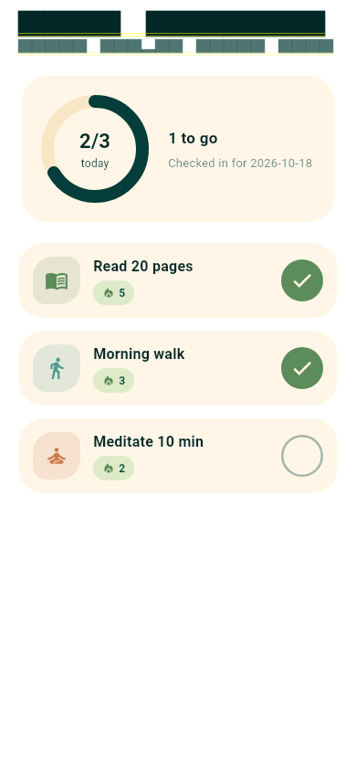
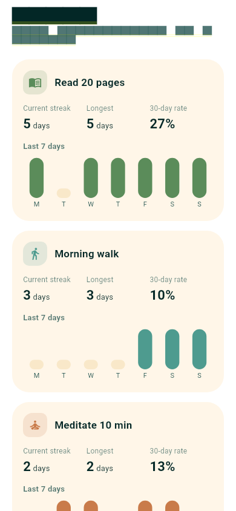

# HabitLoop

[](LICENSE)
[](https://flutter.dev)
[](https://dart.dev)


*Created by devuvo*

A calm, organic habit tracker with streaks — a **true native mobile app** built with **Flutter (Dart)**. Big tappable check circles, streak flames, a progress ring, per-habit stats with 7-day charts, and optional daily reminders. 100% on-device: no backend, no account, no tracking.

**Design:** Organic / biophilic — soft blobs, curved shapes, rounded cards; calm and human.
**Palette:** Ink Teal `053D3A` + Warm Sand `FFE2B8` (deep teal surfaces, warm sand backgrounds, cream cards).




## Run it

```bash
flutter pub get
flutter run
```

## How streaks work

A streak is a run of consecutive calendar days with a check-in (`lib/services/streak.dart`, pure Dart — fully unit-tested). If today isn't checked yet but yesterday was, the streak stays alive (grace); it only breaks when a full day passes unchecked. Weekly habits (e.g. "3× per week") score per ISO week instead: consecutive qualifying weeks.

## Project structure

```
lib/
  main.dart                  # app entry, bottom nav
  theme.dart                 # design tokens (palette, radii)
  models/                    # Habit, CheckIn (JSON-serializable)
  providers/habit_provider.dart  # state (ChangeNotifier)
  screens/                   # today, habits, stats
  widgets/                   # habit tile, streak badge, progress ring, week chart
  services/
    streak.dart              # pure streak math (unit-tested)
    storage.dart             # shared_preferences persistence
    notifications.dart       # daily reminder scheduling
test/
  streak_test.dart           # streak edge cases
  widget_test.dart           # today screen renders, check toggles
```

## Notes & limitations

- **Persistence:** `shared_preferences` (JSON) — honest scope for a demo. A production app with thousands of check-ins would use drift or isar.
- **Reminders:** `flutter_local_notifications` schedules daily reminders on-device. Exact alarm behavior varies by Android version — verify on a physical device.
- **Tests:** `flutter test` runs the unit + widget suites. UI screenshots in `docs/` were captured from widget tests.
- No secrets anywhere — there is nothing to leak; the app never touches the network.

## License

devuvo Community License v1.0 — free for personal/educational/non-commercial use with visible credit to devuvo. Commercial use needs prior written approval at admin@devuvo.com. See [LICENSE](LICENSE).
